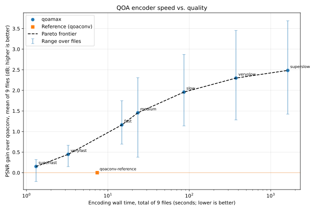

# QOAMAX - High-Quality QOA Encoder/Decoder Library and CLI tool

QOAMAX is an encoder + decoder implementation for the QOA codec and file format,
usable as a library inside other applications as well as a standalone CLI tool.

The library can be used stand-alone without any dependencies or even memory allocations,
and compiles with any C23 compiler, including cproc. With gcc or clang it also uses SIMD
(see [Compiler support](#compiler-support)).

QOAMAX features an optimized decoder implementation tuned for various SIMD extensions (2.5x on a Ryzen 5900X).

QOAMAX implements multiple parametrizable, optimized encoders, from highly performant to high-quality.  
On a pop song, the tradeoff currently looks like this (Ryzen 5900X, placebo and ultrafast missing):  


## Compilation

TLDR:
```bash
$ git clone https://gitlab.com/BlobCodes/qoamax.git
$ make # builds build/qoamax
$ make install # installs into PREFIX
```

Run `make` inside the repo root to build the CLI tool.
This builds the optimized `build/qoamax` and a sanitizer-enabled `build/qoamax-debug`.

Use `make release` to only build `build/qoamax`, use `make test` to run the tests.

`make install` installs the CLI, the library, its headers and a pkg-config file (`PREFIX=/usr/local`, `DESTDIR`).

`make lib` builds the static and shared library (`build/libqoamax.a`, `build/libqoamax.so`).
CMake and Meson can be used to include the library too, see [Using the library](#using-the-library).

**Notice that the library is noticeably faster when compiled with clang instead of gcc.**

## Usage

The tool features a `decode` and an `encode` command, which should both be self-explanatory:

```sh
$ qoamax -h
$ qoamax encode -h
$ qoamax encode input.wav output.qoa --effort=slow
$ qoamax decode output.qoa decoded.wav
```

`--effort` selects the speed/quality tradeoff of the encoder: `ultrafast`, `superfast`, `veryfast`, `fast`,
`medium` (default), `slow`, `veryslow` or `placebo`.

`encode` reads WAV files (8 to 32-bit integer or 32/64-bit float PCM) and raw 16-bit little-endian PCM.
Raw input is used for `.pcm`/`.raw` files, with `--format=raw`, or when `--rate`/`--channels` is given
(defaults: 48000 Hz, mono).
`decode` writes 16-bit WAV files, or raw PCM for `.pcm`/`.raw` files and with `--format=raw`.
Use `-` for stdin/stdout to convert other formats with e.g. ffmpeg:

```sh
$ ffmpeg -i input.flac -f wav - | qoamax encode - output.qoa
$ qoamax decode input.qoa - | ffmpeg -i - output.flac
```

## Using the library

The library has no dependencies and doesn't allocate memory.
It consists of `src/qoamax.c`, which needs a C23 compiler,
and the header `src/qoamax.h`, which is plain C11/C++11,
so the rest of your project can use any compiler and standard from those on.
Build the library with optimizations: the encoder is many times slower without them.

**Copy the source** into your project: `src/qoamax.h`, `src/qoamax_plain.h` (plain declarations for C++ and C
compilers without VLA parameters, included by `qoamax.h`), `src/qoamax.c`, `src/qoamax_lanes.h` and
`src/qoamax_beam.h`. Compile `qoamax.c` as its own file, with
e.g. `-std=c23 -O3`.

**CMake** (3.21 or later), with `FetchContent` or `add_subdirectory`:

```cmake
include(FetchContent)
FetchContent_Declare(qoamax GIT_REPOSITORY https://gitlab.com/BlobCodes/qoamax.git GIT_TAG main)
FetchContent_MakeAvailable(qoamax)
target_link_libraries(your_target PRIVATE qoamax::qoamax)
```

After installing it (`cmake -B build && cmake --build build && cmake --install build`), use `find_package(qoamax)`
and the same `qoamax::qoamax` target. `BUILD_SHARED_LIBS=ON` builds a shared library, `QOAMAX_BUILD_CLI` and
`QOAMAX_INSTALL` select whether the CLI is built and the files are installed (by default only if qoamax is the
top-level project). Its default build type is `Release`, but as a subproject it uses your project's build type.

**Meson** (1.4 or later), as a subproject with a wrap file `subprojects/qoamax.wrap`:

```ini
[wrap-git]
url = https://gitlab.com/BlobCodes/qoamax.git
revision = main

[provide]
dependency_names = qoamax
```

Then `dependency('qoamax')` finds it, installed or as a subproject. The CLI isn't built as a subproject
(option `cli`). On Windows, build it as a static library (`default_library=static`), as Meson doesn't export the
symbols from a DLL.

**Installed** (by `make install`, CMake or Meson): `pkg-config --cflags --libs qoamax`.
Before version 1.0, every minor version may change the ABI (the shared library's soname is `libqoamax.so.0.1`).

## Compiler support

The library's source (`src/qoamax.c`) is standard C23 and compiles with any C23 compiler (tested with gcc 16,
clang 23 and [cproc](https://sr.ht/~mcf/cproc/); older gcc/clang versions with C23 support may work). It needs no
library functions besides `memcpy`, and uses the C23 headers `<stdckdint.h>` and `<stdbit.h>` (if the C library
lacks `<stdbit.h>`, gcc and clang use a builtin instead).

gcc and clang (and other compilers defining `__GNUC__`) also get the fast paths, which use GNU extensions:

- vector extensions (`__attribute__((vector_size))`) for the SIMD encoder searches (SSE2/AVX2/AVX-512, NEON, SVE,
  RVV), and `__builtin_cpu_supports` with `[[gnu::target]]` functions for choosing AVX2/AVX-512 at runtime,
- `[[gnu::always_inline]]`/`[[gnu::noinline]]`, `#pragma GCC unroll` and `__builtin_expect` as optimizer hints.

Other compilers ignore the attributes and pragmas, and build only the scalar code. The output is the same, but the
encoder may be much slower: the hot loops are tuned for clang and gcc. Note that the C23 headers must suit the
compiler: with cproc, glibc's `<stdbit.h>` and gcc's `<stdckdint.h>` don't work, as they use GNU builtins (the tests
use the replacements in `test/c23-include`).

The C23 features include variably modified (VLA) parameters, e.g. `samples[static restrict samples_count]`, which
compilers without full C23 support may lack (they were optional in C11). MSVC can't compile it; clang-cl should
work, but is untested. The public header `src/qoamax.h` has none of these requirements: it is plain C11 and C++11.
